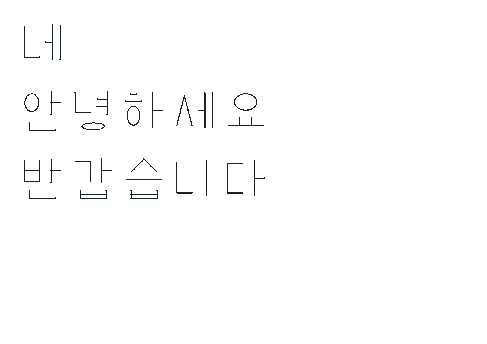
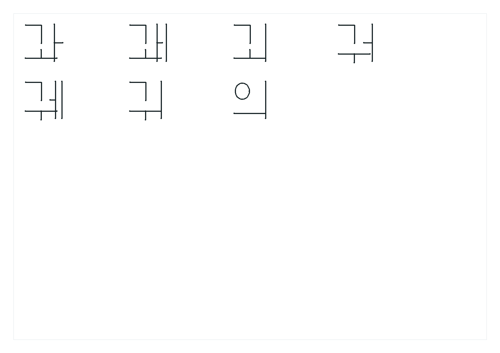
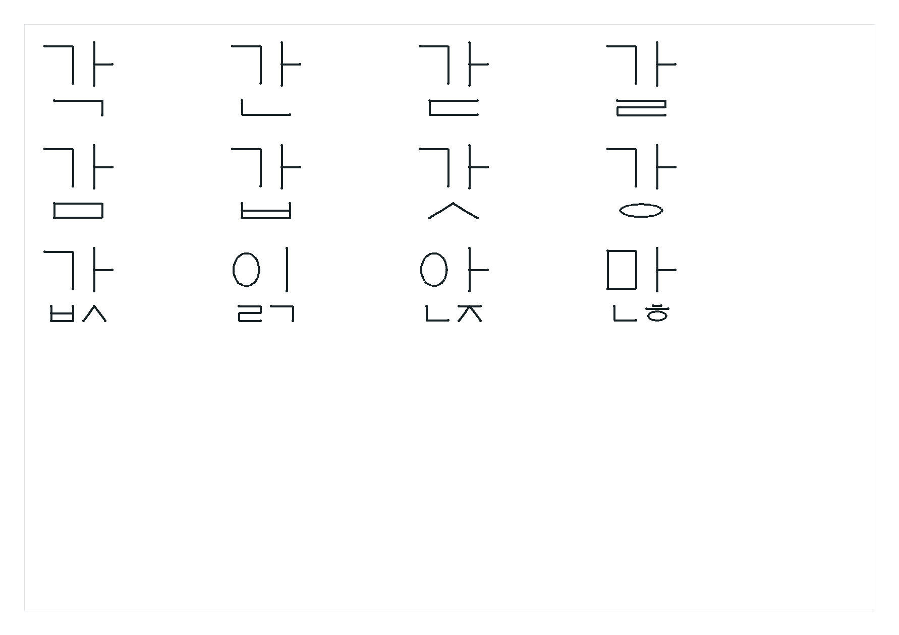
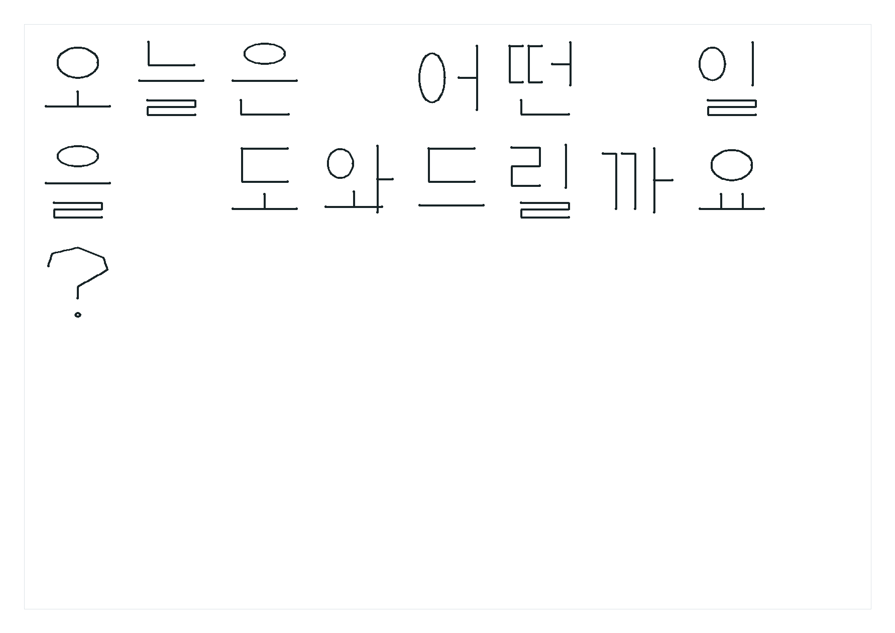

# M0 화면 가독성 부분 검수

검수·기록 날짜: **2026-10-12 (KST)**. 개발 기간: **2026-10-07~**.

| 항목 | 내용 |
| --- | --- |
| 검수자 | 사용자 |
| 대상 | `네`, `안녕하세요`, `반갑습니다`를 순서대로 세 줄에 배치 |
| 조건 | A4 가로, 글자 배치 칸 28mm, 시작 y=11.75 / 53.25 / 94.75mm |
| 자료 | 계획된 획의 2D 미리보기. 로봇 실행 결과가 아님 |
| 사용자 원문 | “완전 잘 알아볼 수 있을 거같아” |
| 판정 | 세 문장에 대한 긍정적인 육안 가독성 평가 |
| 검수 한계 | 원문을 아는 상태. 별도 판독 답안·정답 비공개 판독은 수행하지 않음 |
| 마일스톤 | M0 부분 검수 진행. 전체 완료 아님 |

위 세 문장 평가는 첫 번째 검수 이력이며 아래 후속 검수를 추가했다.
어려운 형상이 발견되면 수정 후 다시 검수한다.
실물 붓펜 가독성·필압·잉크·반복 필기는 미검증이며 M5·M6에서 별도 평가한다.

[구조화된 검수 기록](assets/2026-10-12-m0-three-lines-review.json).

## 후속 샘플 검수: 2026-10-12

동일한 A4 가로·28mm·2D 획 미리보기로 대표 글자, 복합 모음, 받침, 자동 줄바꿈을 제시했다.

| 대상 | 사용자 판정 | 다음 조치 |
| --- | --- | --- |
| `가 한 글` | 개별 판정 미수신 | 확인 대기 |
| 복합 모음 | 나쁘지 않으나 `궈`, `궤`의 모양 차이 지적 | ㅝ·ㅞ의 획 비율·간격 수정 후 재검수 |
| 받침 | “받침은 확실해 괜찮아” | 사용자 육안 검수 통과 |
| 자동 줄바꿈 | “자동 줄바꿈도 괜찮고” | 사용자 육안 검수 통과 |

코드 확인: 혼합 모음이 동일한 배치 상자를 사용한다. `궈`는 ㅜ의 가로획 끝과 ㅓ의
세로획이 가까우며, `궤`는 압축 배치된 ㅔ의 첫 세로획을 ㅜ 가로획이 가로지른다.
획 정의의 비율·간격 문제이며 펜 필압이나 실물 로봇의 문제를 검증한 것은 아니다.
이번 응답에서는 획 코드를 바꾸지 않고 수정 필요 사항만 기록했다.

**M0는 아직 진행 중이다.** `궈`·`궤` 수정 후 사용자 재검수와 대표 글자 확인이 남는다.
[구조화된 후속 검수 기록](assets/2026-10-12-m0-remaining-review.json).

