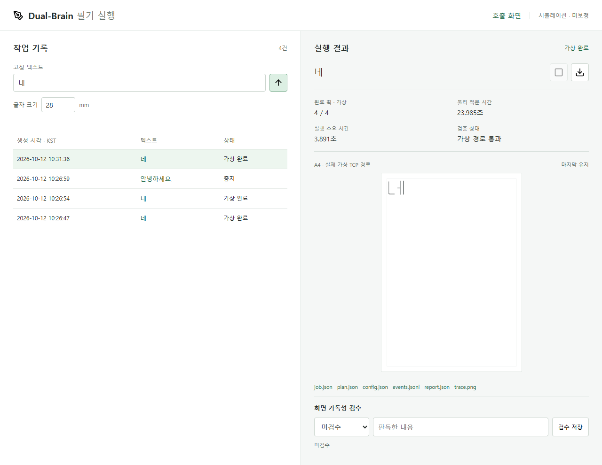

# 2026-10-12 결과: 가상 조건 확장과 실행 관리

착수 / 시험 / 기록: **2026-10-12 (KST)**. 개발 기간: **2026-10-07~**.
사용자의 두 단계 연속 진행 승인에 따라 로봇 없이 구현·검증했다.
두 소프트웨어 하위 단계는 검증했지만 M0 사람 검수와 실물 시험은 완료하지 않았다.
구현 당시에는 로컬 변경으로 보관했다. 이후 **2026-10-12** 사용자 승인으로
`codex/korean-brushpen-response` 브랜치에 코드·테스트·선별 증거와 함께 게시한다.

## 1단계: M1 가상 장착·종이 조건 확장

**문제:** 2026-10-07의 한 가상 설정에서 통과했다고 다른 장착·종이 배치도
통과하는 것은 아니다. 설정을 바꾼 경로를 재검사하고 거부 이유를 남겨야 한다.

**구현:** [조건 비교 실행기](../../kwon_lab/writing/evaluation.py)와
[CLI](../../kwon_lab/tools/writing_evaluation.py)를 추가했다. 10개 프로필에 기존
7종 경로를 적용하고 기본 프로필에는 넓은 선·영역 밖 행·긴 문장의 3개 대조 경로를 추가했다.
매 조건마다 전체 기구학 사전검사를 다시 수행하고 통과한 경우에만 가상 모터를 적분한다.
설정·시간·오차·거부 사유를 [요약 JSON](assets/2026-10-12-condition-summary.json)에 남긴다.

**통제 조건:** 같은 대기 관절, 2배 시간표, 5ms 적분, 기존 오차·속도·충돌 기준을 유지했다.
대기 자세를 자동으로 다시 보정하거나 기준을 느슨하게 바꾸지 않았다.
50~80mm는 가상 그리퍼 좌표의 붓끝 오프셋이며 제품 전체 길이나 실측 파지 위치가 아니다.

| 가상 조건 | 통과 / 비교 건수 | 결과 해석 |
| --- | --- | --- |
| 기본 60mm | 7/10 | 기존 7종 통과, 추가 대조 3종은 거부 |
| 붓끝 오프셋 50mm | 7/7 | 해당 조건의 전체 경로 추종 확인 |
| 붓끝 오프셋 55mm | 7/7 | 해당 조건의 전체 경로 추종 확인 |
| 붓끝 오프셋 70mm | 0/7 | 기존 대기 자세의 붓끝 높이 약 6.18mm, 최소 12mm 미달 |
| 붓끝 오프셋 80mm | 0/7 | 기존 대기 자세의 붓끝 높이 약 -3.82mm, 시작 거부 |
| 종이 world y +5mm | 7/7 | 종이 이동 후 새 경로 검사·추종 통과 |
| 종이 world x -5mm | 7/7 | 종이 이동 후 새 경로 검사·추종 통과 |
| 종이 평면 회전 10도 | 7/7 | 회전한 종이 좌표로 전체 경로 추종 통과 |
| 작업영역 `(8,8)~(35,35)`mm | 4/7 | `네·가·한·글` 통과, 직선·네모·문장은 영역 초과 |
| 공중 이동 높이 30mm | 0/7 | 접근 IK 비수렴으로 적분 전 거부 |

총 **73건 비교: 46건 통과, 27건 거부**. 불가능 조건을 의도적으로 포함했으므로
46/73을 성공률·가독성·실물 성능으로 해석하지 않는다.
기본 7종의 결과는 이전 기준선을 유지하며, 통과한 다른 조건도 테스트한 경로만 검증한 것이다.
전체 장착 범위나 A4 전체 도달영역이 검증됐다는 뜻이 아니다.

**넓은 경로 결과:** `(12,12)→(140,40)`mm 선은 마지막 점의 이탈 IK가 비수렴해
전체 경로 거부, y=90mm 행은 후보 영역 밖으로 거부, `안녕하세요. 반갑습니다.`는
후보 x=150mm 영역을 넘어 거부됐다. 자동 용지 재배치나 임의 경로 축소는 하지 않는다.

**결론:** 장착을 바꾼 뒤 예전 대기 자세를 그대로 사용하면 문제가 생길 수 있음을
검출했다. 70/80mm가 어떤 보정에서도 불가능하다는 증명은 아니며, 별도의 대기 자세·
영역을 설정하면 새 시험이 필요하다. 물리 장착 허용값으로 확정하지 않는다.

## 2단계: M2 시뮬레이션 실행 관리·영구 기록

**문제:** 이전 호출 화면은 탭 안의 2D 애니메이션과 임시 기록이었다. 탭 간 중복
실행을 막거나 시뮬레이션 중지·실패·완료와 설정을 서버에 보관할 수 없었다.

**구현:** [작업 관리자](../../kwon_lab/writing/jobs.py), `/api/jobs`와 `/jobs` 화면을 추가했다.
직접 입력한 고정 텍스트를 사용하며 AI가 질문에 답하는 기능은 아니다.
기존 `야 → 네` 2D 화면은 `/`에 유지하고 별도 실행 기록 화면으로 이동할 수 있다.

| 기능 | 구현·검증 내용 |
| --- | --- |
| 실행 흐름 | 계획 -> 전체 사전검사 -> 가상 구동 -> 결과 검사 -> 완료/중지/실패/불확실 |
| 중복 방지 | 서버 스레드 잠금으로 같은 관리자에서 한 작업만 실행, 다른 탭 요청은 HTTP 409 |
| 프로세스 소유권 | 같은 기록 폴더의 OS 파일 잠금, 두 번째 서버/관리자 소유를 거부 |
| 중지 | 요청 토큰을 사전검사·IK·적분에 전달, 물리 적분 중에는 기존 유지 중지 사용 |
| 상태 구분 | `completed`, `stopped`, `failed`, `uncertain`, `interrupted`를 별도 기록 |
| 결과 검증 | 정상 전체 가상 경로의 완료·복귀·검증·실행 미허가 플래그 확인; 계약 누락은 불확실 |
| 저장 | 작업 UUID, KST 시각, 설정, 계획, 결과, 단계 JSONL, 실제 TCP 경로 PNG |
| 획 수 | 전체 통과 시 계획 획 수, 중지 시 펜 올림 단계 도달의 가상 집계; 잉크·가독성 판정 아님 |
| 시간 | CPU/벽시계 실행 소요와 가상 물리 적분 시간을 구분 |
| 검수 | 화면 판독 결과를 사람이 명시적으로 저장; 기본 `unreviewed`, 실물 판독과 구분 |
| 재시작 | 완료 기록을 다시 읽고, 실행 중이던 기록은 `interrupted`로 전환; 자동 재실행 없음 |
| 오류 처리 | 실행기 오류, 기록/이미지 오류, NaN, 벽시계 제한 초과, 늦은 중지의 미관측을 성공 처리하지 않음 |
| 저장 실패 | 추가 작업을 차단, 종료·재시작으로 실패를 없었던 일로 처리하지 않음 |
| 접근 제한 | 기존 루프백 Host/Origin 보호 유지, 작업 ID·파일 allowlist, 임의 경로 다운로드 차단 |

작업 제한 시간은 기본 120초 **벽시계**다. 기존 적분/IK의 중지 콜백을 통한 협력적
중지이며 멈춘 프로세스를 강제로 종료하는 장치나 실물 비상정지 보장이 아니다.
기록 소유권은 **같은 폴더**에 적용되며 서로 다른 기록 폴더의 모든 서버를 전역 차단하지 않는다.
손상된 기록은 정상 이력으로 조용히 건너뛰지 않고 기록 열기를 거부한다.



[모바일 결과](assets/2026-10-12-jobs-mobile.png),
[중지 결과 화면](assets/2026-10-12-jobs-stopped.png),
[브라우저 시험 요약](assets/2026-10-12-jobs-ui-summary.json).
이미지는 실제 가상 TCP의 투영이며 종이에 쓴 사진·OCR 결과가 아니다.

## 2026-10-12 검증 결과

| 검사 | 결과 |
| --- | --- |
| Python 필기 관련 회귀 | **104/104 통과**: 기존 77 + 조건 비교 3 + 작업 관리자 18 + HTTP 6 |
| 실제 MuJoCo 연결 | `네` 완료·실제 상태 경로 저장, 긴 문장 영역 초과 거부, 실행 중 유지 중지 |
| 가짜 실행기 | 정상·거부·오류·불확실·시간 초과·늦은 중지·저장 실패·종료 중지 구분 |
| 프로세스/동시성 | 6개 동시 제출 중 1개만 수락, 같은 폴더의 별도 프로세스 소유 차단 |
| 실행 관리 UI | 1280×900 / 390×844: 실제 경로 픽셀·파일 다운로드·날짜·아이콘·텍스트/가로 넘침 검사 통과 |
| 두 탭 | 실행 중 다른 탭의 시작 비활성화와 API 409, 부분 획 중지 후 안정화, 잘못된 문자 작업 거부 |
| 기존 호출 UI 회귀 | 1280×800 / 390×844: 완료·중복 방지·중지/재시도·실패·다운로드·캔버스·배치 통과 |
| 서버 재시작 | 완료 2건·중지 1건 기록 보존, 활성 작업 없음, 사람 검수는 모두 미검수 유지 |
| 사람·실물 | 가독성 사람 검수 미완료, 실물 연결·모터·필압·잉크·반복 필기 시험 0회 |

마지막 브라우저 중지 시험에서는 `안녕하세요.`의 가상 획 **3/24**만 완료 상태로
집계됐다. 대응하는 로컬 `report.json`에서 중지 안정화 약 **0.145초**, 최대 추가
TCP 이동 약 **0.224mm**, `trajectory_complete=false`를 확인했다.
중지 요청은 벽시계/UI 시점이므로 실행마다 중지 위치와 값은 달라질 수 있다.

## 재현과 다음 순서

저장소 루트의 PowerShell:

```powershell
& '.\.venv\Scripts\python.exe' -X utf8 kwon_lab/tools/writing_evaluation.py `
  --output outputs/writing/condition-review
& '.\.venv\Scripts\python.exe' -X utf8 kwon_lab/tools/writing_chat.py `
  --port 8765 --records outputs/writing/jobs
& '.\.venv\Scripts\python.exe' -X utf8 -m unittest discover -s tests -p 'test_writing*.py' -v
node tests/writing_jobs_ui.cjs
node tests/writing_chat_ui.cjs
```

UI 검사는 Node.js·Playwright·설치된 Edge가 필요하다. 별도 서버 주소는
`WRITING_TEST_URL`, Playwright 모듈 경로는 환경에 맞는 `NODE_PATH`로 지정한다.
화면: `http://127.0.0.1:8765/jobs`. 포트가 사용 중이면 다른 `--port`를 선택한다.
모든 작업 데이터의 `motion_authorized=false`, 실물 보정 필요 상태를 유지한다.

**후속:** 이 두 단계 이후 M2 종이 사용 위치·겹침 방지·수동 새 종이 초기화를
다음 구현 대상으로 추가했고, 별도의 사용자 승인으로 [구현·검증](paper-space.md)했다.
M0 대표 글자·문장의 사람 화면 판독도 필요하다. 장비 준비 후에는
M3 장착·종이·관절 보정부터 진행한다. 속도 최적화는 별도 비교 시험으로 남기며
이번 두 단계에서는 시간표·모터 게인·속도 제한을 바꾸지 않았다.
AI·음성 통합은 M6 고정 문장 반복 판독 관문 뒤의 순서를 유지한다.

**2026-10-12 방향 추가:** 종이 준비·고정·교체는 사람이 맡고 로봇은 LLM 출력의
필기만 맡는다. 자동 종이 교체는 제외한다. 기존 각 작업은 같은 위치에서 독립적으로
시뮬레이션되므로 작업 기록 저장과 별개로 종이 점유 관리가 필요하다. 공간 부족 차단,
부분 실패 영역 보존, 재시작 복원과 사람이 누르는 `새 종이 준비 완료`를 M2 후속으로
명시했다. 이 추가는 문서 변경이며 두 단계의 시험 결과를 새 기능 검증으로 확대하지 않는다.
이후 종이 관리 구현의 127개 회귀·화면·실제 가상 구동 결과는 별도 [M2 기록](paper-space.md)에 있다.

작업 중 화면 꺼짐은 허용하되 시스템 자동 절전을 막는 임시 Windows 요청을 적용했다.
전원 계획을 영구 변경하지 않으며 작업 종료 후 해제한다. 덮개 닫기·강제 절전·
전원 끄기·앱 종료까지 막거나 작업 지속을 보장하는 기능은 아니다.
