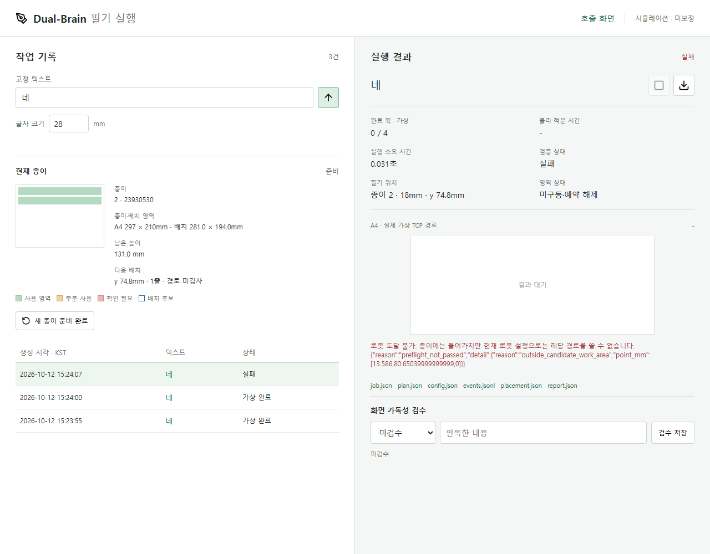

# A4 가로 전체 배치와 실패 이유 구분

수정·시험·기록: **2026-10-12 (KST)**. 개발 기간: **2026-10-07~**.
실물 로봇 없이 소프트웨어와 MuJoCo만 사용한다. 구현 당시에는 로컬에 보관했고,
이후 **2026-10-12** 사용자 승인으로 개발 브랜치에 게시한다.

**2026-10-12 후속:** 아래의 작은 로봇 후보 영역은 최초 가로 전환 당시 설정이다.
이후 [로봇 경로 재검증](landscape-reach.md)에서 종이 원점을 (0.160, -0.070, 0.005)m로
이동하고 가로 A4 후보 경계 안의 `네 → 안녕하세요` 28mm 경로를 통과시켰다.
A4 전체의 모든 위치·세 번째 줄은 아직 통과하지 않았다.

## 수정 이유

초기 종이 원장이 로봇 후보 작업영역 142×72mm를 종이 배치 한계로 사용해,
A4에 빈 공간이 많아도 `종이 공간 부족`을 표시했다. 종이 배치와 로봇 도달 검사를 분리했다.

## 현재 기준

| 항목 | 값·정책 |
| --- | --- |
| 종이 | A4 가로 297×210mm |
| 전체 배치 기준 | 가장자리 8mm를 제외한 x=8~289, y=8~202mm, 281×194mm |
| 응답 예약 여유 | 위아래·좌우 3.75mm, 행 사이 6mm, 이전 정책 유지 |
| 실제 글자 배치 폭 | 273.5mm, 글자 사이 3mm |
| 28mm `안녕하세요` | 한 줄, 예약 높이 35.5mm, 새 종이 y=11.75mm에서 시작 |
| 18mm 한 줄 응답 | 종이 배치상 6행 가능. 로봇이 6행을 쓸 수 있다는 의미는 아님 |
| 로봇 후보 영역 | 기존 x=8~150, y=8~80mm 유지. 실제 도달 범위로 보정한 값이 아님 |
| 미리보기 | 종이 배치만 계산, 로봇 경로 미검사 |
| 실행 | 배치 후 기존 전체 경로·IK·관절·충돌·동역학·중지 검사 유지 |

저수준 기구학 시험의 기존 세로 기본값은 재현을 위해 유지한다.
사용자가 사용하는 `/jobs`와 `/` 호출 미리보기는 가로 A4를 사용한다.
가로 A4 전폭의 실제 필기 성공은 아직 검증하지 않았다.

## 실패 구분

| 표시·분류 | 조건 | 종이 처리 |
| --- | --- | --- |
| 종이 공간 부족 / `paper_space` | 남은 줄에 들어가지 않음 | 작업 생성 전 차단, 새 종이 확인 필요 |
| 종이 공간 부족 / `paper_space` | 새 종이에도 너무 긴 문장·큰 글씨가 들어가지 않음 | 작업 생성 전 차단, 새 종이로 바꿔도 해결되지 않으므로 크기·길이 조절 안내 |
| 로봇 도달 불가 / `robot_reach` | 후보 영역 초과, IK 미수렴, 액추에이터 제어범위 초과 | 적분 전 미구동 증거가 있으면 예약 해제. 종이를 가득 찼다고 처리하지 않음 |
| 로봇 검증 실패 / `robot_validation` | 충돌·추종·속도·안전 검사 등 | 기존 부분 사용·불확실 영역 보존 정책 적용 |
| 실행 또는 기록 오류 / `execution_record` | 실행·저장 실패 | 불확실 영역 보존·추가 실행 차단 정책 유지 |

로봇 검증 실패를 통과시키려고 후보 영역·허용 오차·안전 제한을 확대하지 않는다.
원본 실패 코드와 상세 내용도 결과 파일과 화면에 보존한다.

## 이전 기록 전환

종이 방향과 배치 정책을 설정 서명에 포함했다. 기존 세로 종이는 임의로 가로로 해석하거나
사용 위치를 지우지 않는다. 재시작 후 `새 종이 확인 필요`로 차단하고,
사람이 `새 종이 준비 완료`를 확인하면 이전 기록을 보존한 채 새 가로 종이를 만든다.
실행 중 교체·오래된 탭의 종이 ID·중복 실행 차단도 그대로 유지한다.

## 검증 결과: 2026-10-12

- Python 전체 회귀 **133/133 통과**. 마지막 오류 분류·문구 수정 후 작업 관리자/HTTP **29/29 추가 재검사 통과**.
- 28mm `안녕하세요`가 가로 한 줄에 배치되고, 기존 로봇 후보 영역 밖에서도 배치 자체는 허용됨을 검사했다.
- 동일 문장의 실제 MuJoCo 사전검사는 후보 영역 초과로 거부되며 `robot_reach`로 분류되고, 미구동 예약은 해제된다.
- 데스크톱 1280×1000 / 모바일 390×844: 가로 비율, 색상 영역 픽셀, 서로 다른 두 실제 가상 필기 행,
  세 번째 행의 로봇 도달 거부, 과도한 문장의 종이 공간 부족, 재시작·수동 초기화·오래된 탭·부분 중지 시험 통과.
- 기존 호출 화면 1280×800 / 모바일 390×844: 가로 비율·실제 캔버스 픽셀·JSON·중지/재시도·오류 검사 통과.
- 기존 실행 관리 화면 1280×900 / 모바일 390×844: 가로 TCP 결과 이미지·다운로드·이력·두 탭 중복 차단·안정 중지·잘못된 입력 거부 검사 통과.
- 초기 회귀 검사에서 PNG 크기의 세로 기대값 때문에 실패했다. 가로 1188×840px 기준으로 수정 후 전체 재검사 통과.
- 추가 실행 관리 UI 검사도 이전 840px 이미지 폭을 기다리며 시간 초과가 발생했다. 가로 1188×840px 기대값으로 수정 후 재검사 통과.

선별 증거: [가로 배치 UI 결과 JSON](assets/2026-10-12-landscape-summary.json).

실물 전체 도달·필압·잉크·가독성 시험은 하지 않았다. AI 답변·음성 인식도 추가하지 않았다.
