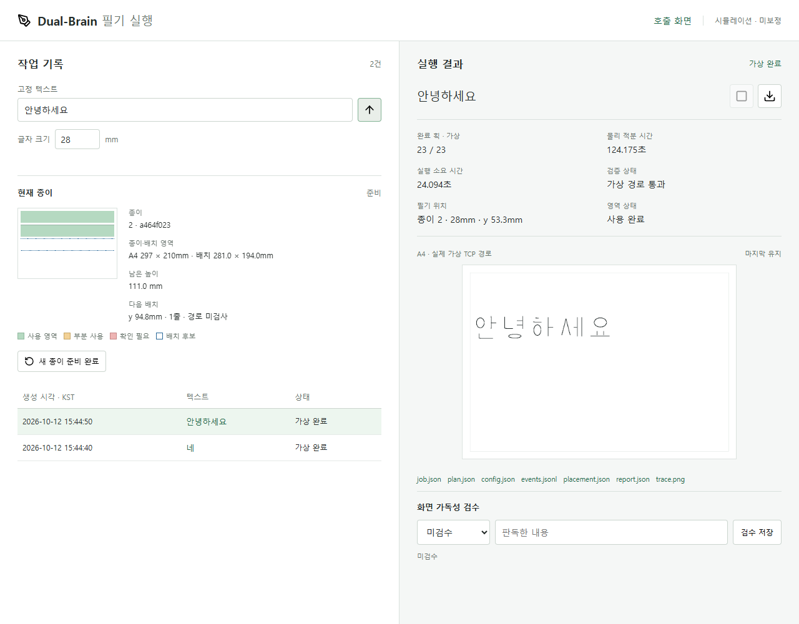

# A4 가로 로봇 경로 재검증

착수·시험·기록: **2026-10-12 (KST)**. 개발 기간: **2026-10-07~**.
범위: 실물 없이 MuJoCo로 가상 종이 위치를 비교하고, 확인된 연속 필기 설정을 적용.
구현 당시에는 로컬에 보관했고, 이후 **2026-10-12** 사용자 승인으로 개발 브랜치에 게시한다.

## 재현한 문제

사용자가 같은 종이에 28mm `네`를 쓴 뒤 28mm `안녕하세요`를 입력했다.
종이에는 들어가지만 기존 후보 영역 x=150mm를 넘는 획 x=156.414mm 때문에 거부됐다.
이전 실패 기록은 보존했다. 영역만 A4 전체로 확장한 대조 시험에서도 기존 종이 위치는
두 번째 문장의 필기 중 IK가 거부됐다. 숫자 제한만 제거해서 해결되는 문제는 아니었다.

## 적용 설정

| 항목 | 이전 | 새 가상 기본값 |
| --- | --- | --- |
| 종이 원점: 로봇 좌표 m | (0.200, -0.040, 0.005) | **(0.160, -0.070, 0.005)** |
| 원점 변화 | - | 로봇 좌표 x -40mm, y -30mm, z 동일 |
| 로봇 후보 검사 영역: 종이 좌표 mm | x=8~150, y=8~80 | **x=8~289, y=8~202** |
| 종이 배치 기준 | A4 가로 전체, 여백 8mm | 변경 없음 |
| 펜·축·대기 관절·이동 높이 | 기존 가상값 | 변경 없음 |
| 속도·오차·충돌·중지 검사 | 기존 제한 | 변경 없음 |

후보 영역은 검사를 허용하는 경계이지, 그 안의 모든 점이 도달 가능하다는 인증이 아니다.
모든 실행은 전체 접근·필기·이탈·복귀와 모터 동역학을 다시 검사한다.
각 작업은 가상 대기 자세에서 시작하고 복귀하는 독립 실행이다.
실제 장착·종이 위치·초기 접근·필압 검증은 M3 이후 별도 수행한다.

## 위치 비교 결과: 2026-10-12

두 시험은 모두 28mm, 같은 종이에 쓴다고 계산한 위치를 사용했다.
호출 시작 y=11.75mm, 다음 문장 시작 y=53.25mm. 도구·대기 자세·안전 제한은 동일하다.

| 후보: 원점 x/y mm | 첫 줄 `네` | 다음 줄 `안녕하세요` |
| --- | --- | --- |
| 기존 200/-40 + 기존 작은 영역 | 통과 | 영역 초과 거부 |
| 200/-40 + A4 후보 영역 | 통과 | 필기 IK 거부 |
| 200/-90 | 통과 | 접근 IK 거부 |
| 190/-80 | 통과 | 필기 IK 거부 |
| 180/-90 | 통과 | 이탈 IK 거부 |
| 170/-90 | 통과 | 통과 |
| 160/-90 | 통과 | 통과 |
| 150/-90 | 통과 | 통과 |
| **160/-70: 선택** | **통과** | **통과** |
| 150/-70 | 통과 | 통과 |

**20건 중 통과 15·거부 5**. 비교 시험 건수이며 실물 성공률이 아니다.
선택한 후보는 두 시험을 통과한 후보 중 기존 원점과의 이동 거리가 가장 작고,
두 번째 문장의 최대 붓끝 속도도 기존 30mm/s 제한 안에 있었다.

| 선택 후보 결과 | `네` 28mm | `안녕하세요` 28mm |
| --- | --- | --- |
| 예약 y 범위 | 8~43.5mm | 49.5~85mm |
| 전체 가상 동작 시간 | 27.840초 | 124.175초 |
| 최대 모터 추종 오차 | 0.441mm | 0.441mm |
| 최대 전체 경로 오차 | 0.847mm | 0.881mm |
| 최대 붓끝 속도 | 20.906mm/s | 25.757mm/s |
| 판정 | 전체 가상 경로 완료 | 전체 가상 경로 완료 |

시간은 MuJoCo 적분 시간이며 화면 대기·CPU 시간·실물 시간과 다르다. 속도 최적화는 하지 않았다.

## 여전히 거부되는 범위

선택한 위치에서 위·아래 모서리 네 곳, 중앙, 세 번째·네 번째 줄의 `네`를 추가로 시험했다.
**7건 중 왼쪽 위만 통과, 나머지 6건은 현재 IK 검사에서 거부**됐다.
따라서 **A4 전폭·전면 필기나 세 번째 줄 성공은 달성하지 않았다.**
현재 구현은 확인된 `네 → 안녕하세요` 두 작업을 통과시키는 가상 설정 개선이다.
더 넓은 사용 범위는 종이 위치·대기 자세·펜 장착을 별도로 비교해야 하며,
IK 거부가 곧 실물의 절대적인 도달 불가능을 증명하는 것은 아니다.
전체 높이·전폭 확장은 **2026-10-12 사용자 결정으로 후속 과제에 보류**했다.

## 실행 화면·기록 전환

새 기본값을 작업 관리자에 적용하고 예전 설정은 `legacy_config()`로 재현 가능하게 남겼다.
기존 실패 회귀 시험은 이전 설정을 명시해 계속 검사한다.
설정 서명이 달라지므로 기존 종이는 보존하고 새 종이 확인 전 추가 실행을 차단한다.
사용자는 화면을 새로고침하고 `새 종이 준비 완료`를 확인한 뒤 28mm `네`, `안녕하세요` 순서로 실행한다.
새로 확인된 종이에서도 모든 문장·모든 위치의 성공을 보장하지 않는다.

## 검증 결과: 2026-10-12

- 데스크톱 1280×1000 / 모바일 390×844에서 같은 종이의 두 28mm 작업 완료·점유·가상 TCP 이미지 픽셀·겹침 방지 확인.
- 같은 종이의 세 번째 28mm `네`는 `robot_reach`로 거부되고 미구동 예약 해제·커서 보존 확인.
- 기존 종이 관리 화면의 공간 부족·도달 거부·새로고침·수동 초기화·부분 중지 회귀 검사 통과.
- 최종 Python 전체 회귀 **136/136 통과**, 120.859초. 실제 가상 모터의 28mm 연속 필기 회귀도 포함한다.
- 2026-10-12 브랜치 게시 전 전체 회귀 재검사도 **136/136 통과**, 126.461초.
- CPU 부하 중 기존 15초 시험 대기 한도로 시간 초과가 발생해, 시험 대기만 90초로 조정했다.
  실행기의 120초 제한·물리 시간·속도·안전 기준은 변경하지 않았다.
- UI 시험을 같은 서버에 동시에 실행해 종이 ID/커서가 바뀐 시험 실패가 있었다.
  새 연속 시험에는 동일 종이 ID 검사를 추가하고 별도 시험 서버에서 재실행해 통과했다.

증거: [위치 비교 20건](assets/2026-10-12-landscape-reach-summary.json),
[추가 위치 7건](assets/2026-10-12-landscape-extent-summary.json),
[독립 서버의 데스크톱·모바일 연속 필기](assets/2026-10-12-landscape-sequence-summary.json).

