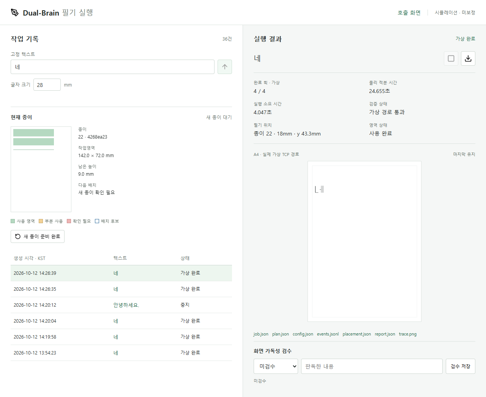

# M2: 종이 사용 위치·겹침 방지·수동 초기화

착수 / 시험 / 기록: **2026-10-12 (KST)**. 개발 기간: **2026-10-07~**.
상태: **소프트웨어 구현·자동 검증**, 사람 가독성·실물 필기는 미검증.
사용자가 승인한 배치·사용 위치 저장·공간 부족·관리 화면·시험 기록의 다섯 항목을 구현했다.
구현 당시에는 로컬 변경으로 보관했다. 이후 **2026-10-12** 사용자 승인으로
`codex/korean-brushpen-response` 브랜치에 코드·테스트·선별 증거와 함께 게시한다.

**2026-10-12 후속 수정:** 배치 기준을 A4 가로 297×210mm 전체(8mm 가장자리 여백)로
변경하고 로봇 후보 도달 영역과 분리했다. 아래 작은 영역의 수치는 초기 시험 이력이다.
현재 동작과 오류 구분은 [A4 가로 배치 수정 기록](a4-landscape.md)을 따른다.

## 역할과 범위

- 사람: 종이를 같은 위치에 준비·고정·교체하고 펜을 장착한다.
- LLM: 추후 답변 내용만 만든다. 현재 실행 입력은 사람이 입력한 고정 텍스트다.
- 프로그램: 빈 줄을 배정하고 전체 경로를 검사하며 종이 사용 위치를 저장한다.
- 로봇: 검증된 경로의 필기만 맡는다. 현재는 MuJoCo 가상 로봇이며 실물 명령은 없다.

자동 종이 집기·교체·교체 감지는 구현하지 않는다. 스킬 완료일도 확정하지 않는다.
기본 작업 간 겹침 방지는 여러 문장 확장 M10보다 먼저 구현한 M2 기능이다.

## 구현한 다섯 항목

| 항목 | 구현과 결과 |
| --- | --- |
| 다음 위치 배치 | 매 작업을 여백이 있는 새 줄에 배치, 후보 작업영역 안에서 자동 줄바꿈, 새 좌표로 전체 사전검사·동역학 실행 |
| 사용 위치 저장 | 종이 UUID·번호·예약/사용 영역·다음 y 위치·설정 서명을 `pages.json`에 영구 저장, 재시작 복원 |
| 공간 부족·수동 초기화 | 공간 부족이면 작업 생성/구동 전에 차단, 사람이 `새 종이 준비 완료`를 확인하면 새 UUID로 시작, 이전 사용 기록 보존 |
| 관리 화면 | 현재 종이·작업영역·남은 높이·색상별 사용 영역·다음 배치 후보 표시, 선택한 작업의 위치/영역 상태 표시 |
| 검증·기록 | 연속 실제 가상 구동, 부분 중지, 재시작·손상 기록·설정 변경·동시 요청·수동 확인·저장 오류 검사 |

코드: [범위 내 배치](../../kwon_lab/writing/planner.py),
[종이 원장](../../kwon_lab/writing/paper.py), [작업 관리자](../../kwon_lab/writing/jobs.py),
[API](../../kwon_lab/writing/web_server.py), [실행 화면](../../kwon_lab/writing/web/jobs.html).

## 초기 배치와 실제 검사: 2026-10-12

종이는 A4 세로 210×297mm지만 현재 가상 후보 작업영역은
**x=8~150mm, y=8~80mm**, 즉 142×72mm다. A4 전체를 쓸 수 있다고 가정하지 않는다.
종이 좌표의 y는 아래 방향이며 기존 `PaperFrame`은 바꾸지 않고 글자 위치만 이동한다.

기본 예약 여유는 **3.75mm**로, 기구학 위치 허용 0.75mm + 동역학 경로 추종 허용
1mm + 중지 추가 이동 한도 2mm를 더한 개발용 보수적 값이다. 각 응답은 행 전체
폭과 필요한 높이를 예약하며, 예약 행 사이에는 6mm 간격을 둔다.
이 값이 실물에서 충분한 여백·안전거리라는 보장은 없다.

| 같은 종이에 `네` 18mm 두 번 | 첫 작업 | 두 번째 작업 |
| --- | --- | --- |
| 배치 시작 y | 11.75mm | 43.25mm |
| 예약 y 범위 | 8~33.5mm | 39.5~65mm |
| 예약 행 사이 간격 | 다음 행까지 6mm | 다음 커서 y=71mm |
| 결과 | 전체 가상 동작 통과 | 전체 가상 동작 통과 |

정상 결과의 기록된 붓끝 `stroke` 좌표가 각각의 예약 범위 안에 있음을 자동 검사했다.
두 행을 사용하면 남은 높이는 9mm로 최소 8mm 글자와 예약 여유도 넣을 수 없어
새 종이 대기로 전환한다. 글자 크기를 자동으로 줄이지 않는다.
28mm에서는 한 행의 예약 높이가 35.5mm이므로 같은 크기 두 번째 응답은 공간 부족으로 차단된다.

**영역에 들어간다고 구동 가능한 것은 아니다.** 새 위치에 대해 접근·필기·이탈·복귀를
매번 검사한다. 예비 시험에서는 아래쪽 28mm 글자의 이탈 IK가 거부됐다.
영역 확대·자동 위치 탐색·임의 축소로 통과시키지 않는다.
화면의 파란 배치 후보는 **배치만 계산한 결과이며 기구학 검사 전**이다.

## 예약·실패·재시작 정책

예약은 구동 전에 저장한다. 원장과 개별 작업 파일을 하나의 데이터베이스 트랜잭션처럼
취급하지 않으며, 둘 사이에 종료되면 공간을 보수적으로 유지한다.

| 사건 | 영역 처리 | 다음 작업 |
| --- | --- | --- |
| 전체 가상 경로 완료 | `occupied` | 다음 빈 줄 사용 |
| 적분 중 유지 중지 안정화 | `partial` | 해당 행 전체 보존, 다음 빈 줄 사용 가능 |
| 적분 전 사전검사 거부/중지 또는 제어범위 사전 거부의 명확한 증거 | `released_no_motion` | 예약 해제, 이전 커서 복원 |
| 실행 후 실패·계약 불확실·이미지/기록 오류 | `uncertain` | 공간 보존, 종이 확인·교체 전 새 필기 차단 |
| 재시작 시 예약/실행 중 이력 | `uncertain` / `interrupted` | 자동 재실행·자동 공간 회수 없음 |
| 이전 버전 이력에 종이 원장이 없음 | `confirmation_required` | 빈 종이라고 가정하지 않고 수동 확인 요구 |
| 설정 서명 변경 | `confirmation_required` | 새 종이 확인 및 새 설정으로 전체 경로 재검사 |
| 겹친 영역·손상 원장·잘못된 서명/커서 | 원장 로드 거부 | 정상 데이터로 임의 해석하지 않음 |
| 문법은 정상이나 작업 파일과 영역/종이 ID가 불일치 | `inspection_required` | 오래된 원장이 새 작업 영역을 빈 공간으로 만들지 않게 차단 |

수동 초기화는 활성 작업이 없을 때만 가능하며 `confirmed=true`와 현재 종이 ID를
확인한다. 오래된 탭의 초기화·작업 요청은 HTTP 409로 거부한다.
새 종이로 전환해도 이전 페이지·예약·개별 작업 기록은 삭제하지 않는다.
초기화는 당시까지의 작업을 새 종이 전환 이전 이력으로 기록한다. 원장만 이전 상태로
되돌아온 경우에도 개별 작업 기록과 대조하며, 새 종이 확인 전에는 빈 영역으로 재사용하지 않는다.
동일한 종이 위치를 사람이 확인하는 방식이며 위치 변경 시에는 별도 좌표 보정이 필요하다.

각 MuJoCo 작업은 기존의 지정된 공중 대기 관절에서 시작하는 독립 실행이다.
부분 중지 후 실물 현재 자세에서 안전하게 대기 자세로 복구하는 제어까지 구현한 것은 아니다.
실물 이식 시 실제 자세·종이 위치·보정·초기 접근은 M3 이후 별도로 검증해야 한다.

## API와 기록

| API | 용도 |
| --- | --- |
| `GET /api/page` | 현재 종이와 사용 영역 조회 |
| `POST /api/page/preview` | `text`, `character_mm`, `page_id`의 배치 후보 계산, 예약·구동 없음 |
| `POST /api/jobs` | 배치 재계산·구동 전 예약·전체 경로 검사와 실행 |
| `POST /api/page/reset` | 현재 `page_id`와 명시적 `confirmed=true`로 새 종이 전환 |

현재 화면은 작업 요청에 종이 ID를 넣어 다른 탭의 교체와 충돌하지 않게 한다.
기존 API 호출의 ID 생략은 호환용이며, 연속 응답 연결에서는 명시적인 ID를 사용한다.
새 작업에는 `placement.json`, `job.json`의 `placement`·`page_reservation_state`가 추가된다.
루프백 Host/Origin·파일 allowlist·작업/기록 폴더 소유권 보호는 유지했다.

### 2026-10-12 실패와 보완

첫 화면 검사에서는 새 작업 직후 이전 작업의 완료 표시를 읽는 타이밍 문제가 드러났다.
수락 직후 새 작업을 표시하고, 오래된 조회 응답을 무시하도록 수정했다.
검사도 완료 상태뿐 아니라 **같은 작업 ID**까지 확인하도록 바꿨다.

한 브라우저 실행에서는 `os.replace`의 **Windows 접근 거부(WinError 5)**가 발생했다.
해당 작업은 실패·영역 불확실로 기록하고 새 필기를 차단했다. OneDrive 경로에서
관측했지만 정확한 잠금 원인은 확정하지 않는다. 원자적 교체를 포기하지 않고
`PermissionError`만 최대 7회, 대기 합계 최대 1.26초로 제한해 재시도한다.
일반 저장 오류나 계속되는 거부는 여전히 실패·추가 작업 차단이다.
임시/영구 접근 거부를 가짜 파일 시스템 호출로 주입해 구분을 확인했다.

## 2026-10-12 검증 결과

- Python 필기 관련 **127/127 통과**: 기존 104 + 종이/배치/저장 19 + HTTP 4.
- 실제 MuJoCo로 18mm `네` 두 번의 서로 다른 행 실행과 실제 붓끝 범위 검사 통과.
- 데스크톱 1280×1000 / 모바일 390×844에서 사용 영역 픽셀·텍스트/가로 넘침 검사 통과.
- 공간 부족 차단·새로고침 복원·수동 확인 취소/수락·오래된 탭 요청 거부 확인.
- 실행 중 초기화 거부, 실제 유지 중지 후 부분 행 보존과 다음 행 구동 확인.
- 가짜 실행기로 저장 실패·불확실·예약 중 종료·설정 변경·옛 이력·손상 원장 검사.
- 기존 실행 관리와 `야 → 네` 화면 회귀를 유지하며 사람 가독성 검수는 자동 통과시키지 않음.

내용이 다른 고정 답변도 시험했다. 첫 행의 `네` 18mm는 통과했지만 두 번째 행의
`빨간색` 18mm는 `reference_exceeds_actuator_control_range`로 적분 전에 거부됐다.
크기를 **명시적으로 12mm로 선택**하면 같은 두 번째 행에서 통과했다(가상 동작 약 68.720초).
미구동 거부만 공간을 해제하는 회귀를 추가했으며, 임의의 답변/크기가 통과한다고 주장하지 않는다.
이는 사람이 지정한 고정 텍스트이지 LLM이 질문을 이해해 생성한 답변이 아니다.
[호출 18mm 기록](assets/2026-10-12-paper-call-18.json),
[답변 18mm 거부 기록](assets/2026-10-12-paper-answer-18-rejected.json),
[답변 12mm 기록](assets/2026-10-12-paper-answer-12.json).



[모바일](assets/2026-10-12-paper-mobile.png),
[새 종이 전환](assets/2026-10-12-paper-reset.png),
[부분 중지 영역](assets/2026-10-12-paper-partial.png),
[실행·배치·화면 시험 요약](assets/2026-10-12-paper-summary.json).
녹색/노란색/빨간색은 사용 정책에 따른 예약 영역이고 실제 잉크 검출 결과가 아니다.

## 실행과 남은 확인

저장소 루트 PowerShell:

```powershell
& '.\.venv\Scripts\python.exe' -X utf8 kwon_lab/tools/writing_chat.py `
  --port 8765 --records outputs/writing/jobs
& '.\.venv\Scripts\python.exe' -X utf8 -m unittest discover -s tests -p 'test_writing*.py' -v
node tests/writing_paper_ui.cjs
```

화면: `http://127.0.0.1:8765/jobs`. 포트가 사용 중이면 다른 `--port`를 선택한다.
UI 검사는 Playwright·설치된 Edge가 필요하며 환경에 맞는 `NODE_PATH`, 다른 서버에는
`WRITING_TEST_URL`을 지정한다. 원시 산출물은 `outputs/`에 보관한다.

M0 사람 가독성 확인과 실물 장착·보정·필압·반복 시험은 남아 있다.
AI·음성 통합, 속도 최적화, 자동 종이 교체는 추가하지 않았다.
작업 중의 임시 시스템 절전 방지 요청은 종료 후 해제하고 영구 전원 설정은 바꾸지 않는다.
